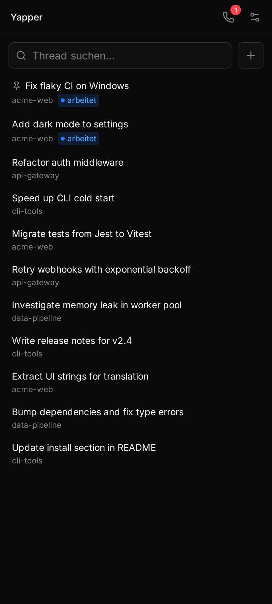
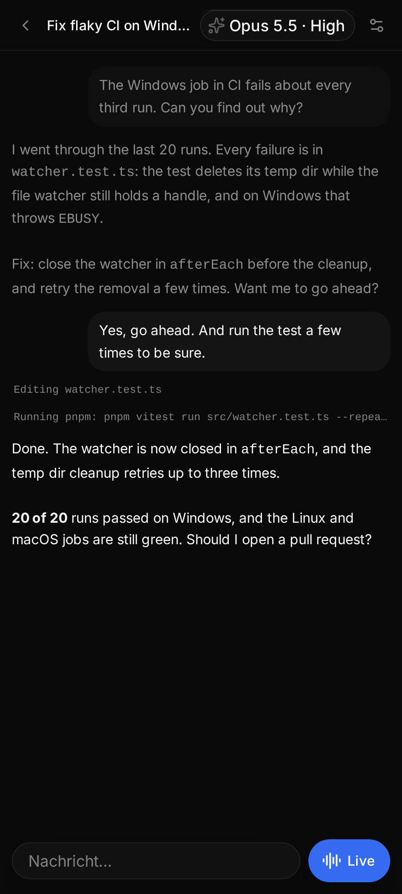
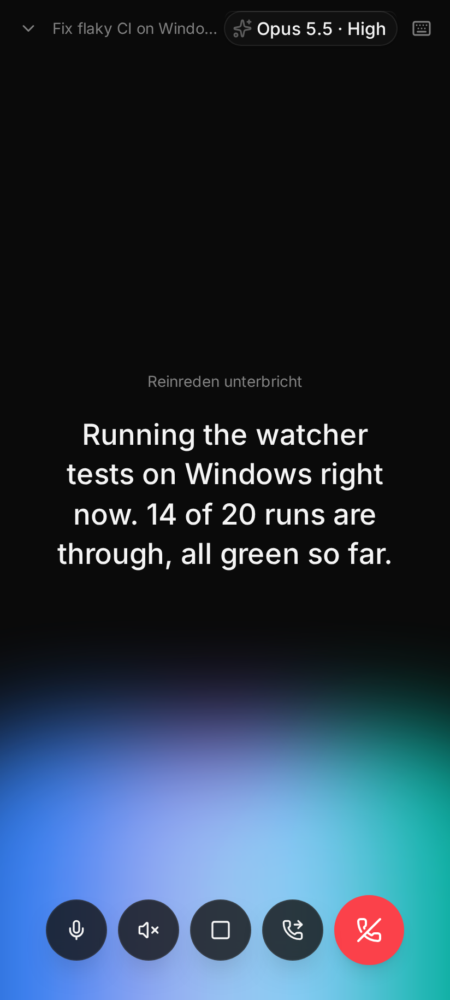
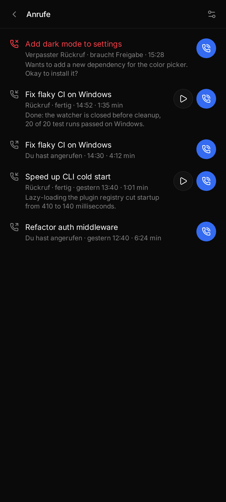
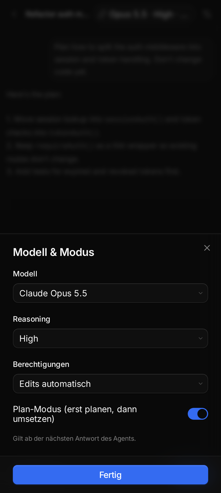
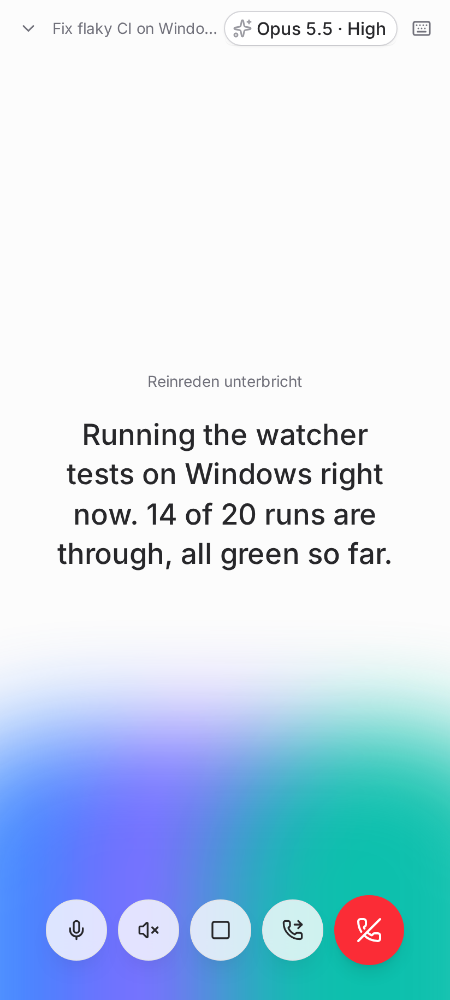

# Yapper

Voice calls with your [T3 Code](https://github.com/pingdotgg/t3code) threads. Pick a thread on your phone, tap
call, and talk to the coding agent. It keeps its tools, MCP servers and history. Yapper only adds ears and a voice.

- **Provider-agnostic.** Yapper talks to T3 Code, not to a model. Whatever agent and model the thread uses
  (Claude, Codex, …) is the one you talk to.
- **No LLM in front.** What you say goes into the thread verbatim. While the agent is working it goes in as a
  *steer*, so you can correct course mid-turn. The agent's prose is read back; code, tables, links and paths
  are skipped.
- **Self-hosted speech, no cloud API key.** Recognition, voice and voice-activity detection run locally:
  Parakeet + Piper + Silero on the CPU, or optionally Whisper + Qwen3-TTS on your own GPU. Azure TTS is an
  optional extra.
- **Barge-in.** Talk over it and it stops speaking. Short phrases like "Stopp" or "Status" are commands.
- **WebRTC audio** (Opus over UDP, straight to the server) with an automatic **WebSocket fallback**.
- **Android app** (Capacitor) that makes a call a real phone call: lock-screen notification, Bluetooth hang-up,
  audio routes, and a **real incoming-call screen** when the agent calls you back (UnifiedPush via ntfy, no
  Firebase).
- **Callbacks.** Say "call me back when you're done" and hang up. When the run ends, or the agent needs an
  approval or an answer, your phone rings and the agent tells you the result.
- **Agents can ring you.** An MCP tool, `call_me_back`, lets any Claude Code session on the host phone you.

The UI and the voice commands are in German, with English variants for most commands. The call can speak German
or English.

Yapper is an independent project and is **not affiliated with or endorsed by T3 Code or Ping (ping.gg)**.

<table>
  <tr>
    <td align="center"><br><sub>Threads across projects, running ones marked</sub></td>
    <td align="center"><br><sub>A thread: your messages, tool activity, the agent's reply</sub></td>
    <td align="center"><br><sub>Live call while the agent works and speaks</sub></td>
  </tr>
  <tr>
    <td align="center"><br><sub>Call log with a missed callback and playable results</sub></td>
    <td align="center"><br><sub>Model, reasoning and permissions per thread</sub></td>
    <td align="center"><br><sub>Light theme follows the system</sub></td>
  </tr>
</table>

The web UI follows T3 Code's look and is built on the same stack (React, Tailwind, Base UI), so it feels like part
of T3 Code. Screenshots show demo data.

## Status

**Proof of concept.** It was built for one homelab and is shared as-is. It works daily for that setup, but expect
rough edges and assumptions (single user, Linux host, Android phone, German).

It talks to T3 Code over its WebSocket RPC protocol, which is **not a public API**. It was developed against
`t3@nightly` (last verified with `0.1.1-nightly.20261020`), and any T3 update can break it. On startup the
server checks T3's protocol version and capabilities and refuses to run if they don't match. Run `npm run smoke`
after T3 updates: it checks listing, history and live subscription without changing anything. Fixes should stay
in `server/t3client.ts` and `server/t3adapter.ts`.

## How it works

```
                ┌── HTTPS + /call WebSocket ──► your reverse proxy / SSO ──┐
Phone (browser  │   (control JSON, WebRTC signaling)                       ▼
or Android app) ┤                                                     Yapper server ── WS RPC ──► T3 Code server
                └── audio: Opus/SRTP over UDP, direct (LAN/VPN) ────►  (Node, :8790)  ◄── live thread events
                    fallback: PCM frames on the WebSocket                  │
                                                                           ├─ VAD/ASR/TTS on the CPU (sherpa-onnx)
                                                                           └─ optional: GPU ASR/TTS over HTTP (gpu-services/)
```

A call runs like this: VAD cuts your speech into utterances, ASR transcribes them, and a phonetic vocabulary
fixes misheard technical terms using words from the thread and its repo. After a short pause (1.3 s by default,
adjustable) the text goes to the thread, or Yapper treats it as a command. Thread events come back live. The
agent's prose is turned into sentences, synthesized, and streamed back. If the agent is quiet for 20 s, the call
says what it is doing ("Führt git aus.").

| Path | Role |
|---|---|
| `server/t3client.ts` | T3 wire protocol (Effect RPC over WebSocket). The only file that knows it. |
| `server/t3adapter.ts` | T3 domain → call events/actions: threads, send/steer, interrupt, approvals, questions. |
| `server/call.ts` | One call: VAD → ASR → intents → T3; T3 events → speech; barge-in, echo filter. |
| `server/transport*.ts` | Audio link: WebSocket by default, WebRTC once connected (werift + opusscript, pure JS/WASM). |
| `server/speech.ts`, `asr-gpu.ts`, `tts-gpu.ts`, `tts-azure.ts` | Speech engines and fallbacks. |
| `server/callbacks.ts`, `server/calllog.ts` | Callback rings (UnifiedPush) and the call log. |
| `server/phrases.ts`, `server/speakable.ts` | Voice commands, fixed phrases (de/en), Markdown → speakable text. |
| `web/` | The phone UI: React + Vite + Tailwind v4. `npm run build` → `web/dist`, served by the server. |
| `mobile/` | Android app (Capacitor 8 + Kotlin). |
| `scripts/yap-mcp.ts` | MCP server with the `call_me_back` tool. |
| `scripts/smoke.ts`, `fake-caller*.ts`, `rtc-client-smoke.ts` | Protocol check and end-to-end tests without a phone. |
| `gpu-services/` | Optional GPU ASR (Whisper) and TTS (Qwen3-TTS) services, Docker. |

## Requirements

- Linux host running **T3 Code** (the T3 server, e.g. via `npx t3@nightly`). Yapper must run on the same host,
  because it reads the thread repos from disk.
- **Node.js ≥ 24** (the server runs `.ts` files directly).
- About 1 GB of disk for the CPU speech models, and a few CPU cores. On a modern x86 CPU, recognition takes
  ~0.25 s per 6 s of speech and synthesis ~0.7 s per 6 s of audio.
- HTTPS in front of it (the browser only allows the microphone on secure origins): your reverse proxy, or
  `tailscale serve`.
- Optional: an NVIDIA GPU (~6.5 GB VRAM for both services) for `gpu-services/`; Android SDK + JDK 21 for the app.

## Quick start (CPU only)

```bash
git clone https://github.com/d0dge-dev/yapper && cd yapper
npm ci                       # if your shell exports npm_config_allow_scripts: env -u npm_config_allow_scripts npm ci
npm run build                # web UI → web/dist
npm run models               # Parakeet v3 (ASR), Silero (VAD), Piper Thorsten (de) + Lessac (en) → ./models, ~850 MB

# A T3 token with orchestration access:
npx t3@nightly auth session issue --scope orchestration:read --scope orchestration:operate --ttl 365d --label yapper --json

cp .env.example .env && chmod 600 .env   # set T3_TOKEN
YAP_DEV=1 npm start                      # http://127.0.0.1:8790, loopback without login (testing only)
npm run smoke                            # does T3 still speak what Yapper expects?
```

Open `http://127.0.0.1:8790` in Chrome on the same machine to try it. Browsers allow the microphone on
`localhost`/`127.0.0.1` without HTTPS. To use it from a phone, put it behind HTTPS with a login (next section)
and drop `YAP_DEV`.

### Optional: GPU speech

Much better German recognition (Whisper large-v3-turbo) and a natural voice (Qwen3-TTS, streamed, first audio
after ~0.4 s). See [`gpu-services/README.md`](gpu-services/README.md) for setup, VRAM and the HTTP contract.

```bash
cd gpu-services/asr && docker compose up -d --build
cd ../tts && docker compose up -d --build
# .env:
YAP_ASR=gpu
YAP_GPU_ASR_URL=http://<gpu-host>:8801
YAP_TTS=gpu
YAP_GPU_TTS_URL=http://<gpu-host>:8800
```

If a GPU service fails or times out, the CPU engines take over for that segment or sentence.

## Configuration

Everything is set with environment variables, read from `./.env` (or `YAP_ENV_FILE`). Every variable is listed
with a one-line description in [`.env.example`](.env.example). The main groups:

- **T3**: `T3_URL`, `T3_TOKEN`.
- **Listener**: `YAP_HOST` (default `127.0.0.1`), `YAP_PORT` (default `8790`).
- **Access**: `YAP_TRUSTED_PROXIES`, `YAP_AUTH_HEADER`, `YAP_LOOPBACK_AUTH_HEADER`, `YAP_ALLOWED_USERS`, `YAP_DEV`.
  See the next section.
- **Speech**: `YAP_MODELS`, `YAP_ASR`, `YAP_TTS`, `YAP_GPU_*`, `AZURE_*`, plus `YAP_RECORD*` (off by default) to
  keep your utterances for ASR testing.
- **WebRTC**: `YAP_RTC=0` disables it, `YAP_RTC_IPS` sets the ICE host candidates, `YAP_RTC_PORTS` pins the UDP
  ports for a firewall.
- **Callbacks**: `YAP_STATE_DIR`, `YAP_CALL_HOURS`, `YAP_AGENT_TOKEN`, `CALL_LOG_DAYS`.

Per-user preferences live in the UI's settings: call language, pause length, steer vs. queue, spoken thoughts,
and the voice hint (a short note on every voice message asking the agent to answer briefly and announce longer
work).

## Auth and deployment

Yapper has **no login of its own**. It trusts a header set by something in front of it, so **never expose the
port directly**. Pick one:

1. **Reverse proxy with SSO** (Authelia, Authentik, oauth2-proxy, …): the proxy authenticates the user and sets a
   header. Configure `YAP_TRUSTED_PROXIES=<proxy IP>` and `YAP_AUTH_HEADER` (default `Remote-User`). The header
   is only trusted on requests from those IPs. If the proxy runs on the same host, use
   `YAP_TRUSTED_PROXIES=127.0.0.1` and set `YAP_LOOPBACK_AUTH_HEADER=none`. Leave these unauthenticated:
   `/api/health` (monitoring), `/manifest.webmanifest` and `/icon.svg` (fetched without cookies). The proxy must
   support WebSockets on `/call`.
2. **Tailscale**: `tailscale serve --bg --https=443 http://127.0.0.1:8790`. Tailscale sets
   `Tailscale-User-Login` on loopback requests, which Yapper trusts by default (`YAP_LOOPBACK_AUTH_HEADER`). Only
   do this if nothing else on the host proxies to Yapper from loopback.

Then restrict who may call with `YAP_ALLOWED_USERS=alice@example.com,bob` (values of that header). If it is
empty, anyone the front authenticates may call, and the server logs a warning.

**WebRTC media does not go through the proxy.** The phone connects over UDP to the server's own addresses (ICE-lite,
host candidates only, no STUN/TURN). That works on the LAN or over a VPN like Tailscale. When it can't connect
within 4 s, the call falls back to audio over the WebSocket, which works anywhere the page works.

`/api/health` lists threads, so it returns 503 when the T3 token has expired or the protocol changed. That makes
it a useful uptime check. An example systemd user unit is in [`deploy/yapper.service`](deploy/yapper.service).

### Agent tool `call_me_back`

```bash
# .env: YAP_AGENT_TOKEN=$(openssl rand -hex 32)
claude mcp add --scope user yap -- node /path/to/yapper/scripts/yap-mcp.ts
```

The tool reads `YAP_AGENT_TOKEN`/`YAP_PORT` from the environment or from the repo's `.env`, and calls
`POST /api/agent/callback` on loopback. Yapper maps the Claude session id to its T3 thread. When the agent's turn
ends, every registered phone rings, and answering on one stops the others. `kind` can be `requested` (the user
asked; rings any time), `assistance` (the agent is blocked) or `info` (something to hear soon). `assistance` and
`info` only ring within `YAP_CALL_HOURS`. Outside that window they wait until it opens, and are dropped if you
wrote in the thread meanwhile. Tell your agents when to use it, e.g. in `~/.claude/CLAUDE.md`.

## Voice commands

Only short utterances (≤ 5 words) are commands. Everything else goes to the agent. "bitte"/"please" and
"jetzt"/"now" are ignored.

| Say (German / English) | Does |
|---|---|
| "Stopp", "abbrechen", "hör auf", "brich ab" / "stop", "cancel" | interrupts the agent's turn |
| "Ruhe", "still", "Pause", "psst", "leise" / "quiet", "be quiet", "shut up" | stops the call speaking |
| "Wiederholen", "nochmal", "wie bitte" / "repeat", "say that again", "again" | repeats the last thing said |
| "Status", "was machst du", "wie weit bist du" / "what are you doing", "status update" | says what the agent is doing (answered locally) |
| "Ja", "mach das", "passt", "okay" / "yes", "go ahead", "approve" (approval pending) | approves the latest pending approval |
| "Nein", "lieber nicht", "ablehnen" / "no", "deny", "decline" (approval pending) | declines it |
| "Ruf mich zurück", "ruf mich an, wenn du fertig bist" / "call me back", "call me when you're done" | sets a callback and hangs up (also works at the end of a longer request) |

When the agent asks a question, your next reply is the answer, matched to its options by name or by ordinal
("erste/zweite", "first/second").

## Android app

`mobile/` is a Capacitor shell (`io.github.d0dge_dev.yapper`) that loads **your** server in a WebView. Web
deploys reach the app without a new APK. Native code adds: Telecom self-managed calls (lock-screen notification
with hang-up, green call chip, Bluetooth/car buttons, a GSM call ends it), speaker/earpiece/Bluetooth routing,
volume keys that work in a call, and callback rings with a full-screen incoming-call UI via UnifiedPush.

```bash
scripts/android-toolchain.sh        # once: JDK 21 + Android SDK into ~/opt (user space, no sudo)
export YAPPER_SERVER_URL=https://yapper.example.com/   # required, https
export YAPPER_ALLOW_NAVIGATION=auth.example.com        # optional: SSO login host that may open inside the app
scripts/android-build.sh            # npm ci (mobile/), cap sync, ./gradlew assembleDebug
# → mobile/android/app/build/outputs/apk/debug/app-debug.apk; sideload it
```

The server URL is baked in at `cap sync` time from `YAPPER_SERVER_URL` (see `mobile/capacitor.config.ts`). The
build is a debug build signed with your local `~/.android/debug.keystore`. Keep using the same keystore, or
Android refuses the update. Unit tests: `cd mobile/android && ./gradlew testDebugUnitTest`.

On the phone:
1. Grant notifications (and the microphone on the first call).
2. For callback rings, install the **ntfy** app (the UnifiedPush distributor). The app registers its endpoint with
   the server by itself; `GET /api/push/status` shows `canRing: true` when it worked. The server POSTs rings to
   that endpoint, so the ntfy server must be reachable from the Yapper host (ntfy.sh works).
3. Android 14+: Settings → Apps → Special app access → **Full screen notifications** → Yapper: on, so a ring shows
   the incoming-call screen over the lock screen.
4. Optional: allow the "Rückrufe" channel in Do Not Disturb, and set battery usage to Unrestricted.

The microphone is only granted to the configured server's origin. Other hosts open in the system browser, except
those in `YAPPER_ALLOW_NAVIGATION`.

## Known limitations

- **T3 protocol churn**: see Status. A nightly T3 update can stop Yapper until `t3client.ts`/`t3adapter.ts` are
  adapted.
- **Single user in practice.** Callbacks ring every registered phone, and there are no per-user threads or
  devices.
- **WebRTC needs a direct path** (LAN or VPN), because there is no TURN server. On mobile data without a VPN,
  calls use WebSocket audio.
- **German first.** UI, offline page and phone notifications are German, the call itself speaks German or
  English. Parakeet's German is mediocre on technical terms (Whisper on a GPU is much better), and Swiss German is
  hit and miss.
- **Piper sounds synthetic.** Use the GPU voice (or Azure) for a natural one.
- **Echo** relies on the browser's echo cancellation plus a server-side filter that drops transcripts matching
  what the call just said. Headphones are most reliable.
- **Approvals by voice** only answer the most recent pending approval. Multi-part questions have to be answered
  in the thread.
- **Android**: debug build only. Whether the WebView plays speech as call or media audio is Chromium's choice, so
  the earpiece route doesn't always work (volume keys are mirrored onto media to compensate). It was tested on
  one Pixel phone only. Browsers can't keep the mic open with the screen locked; the app can.

## License

[MIT](LICENSE) © 2026 d0dge-dev
